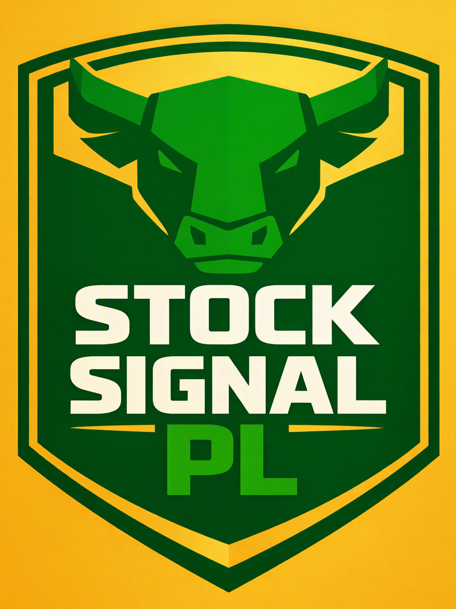

<p align="center">
  
</p>

# StockSignalPL v2.0 — Profesjonalna Platforma Sygnałów i Portfeli GPW (100% Dane Rzeczywiste)

**StockSignalPL v2.0** to zaawansowana aplikacja finansowa zaprojektowana dla inwestorów na polskim rynku kapitałowym (**Giełda Papierów Wartościowych w Warszawie – GPW**). Wszystkie notowania, świece historyczne OHLC oraz wyceny portfeli bazują w **100% na rzeczywistych danych rynkowych** pochodzących z warszawskiego parkietu (WSE GPW), oficjalnej tabeli kursów walutowych Narodowego Banku Polskiego (NBP) oraz światowych rynków surowcowych COMEX / NYMEX (całkowicie wyeliminowano sztuczne generatory ticków i symulację losową).

---

## 🌟 Najważniejsze nowości w Wersji 2.0 (2026-11-05)

1. **Przejście na 100% Dane Rzeczywiste (WSE GPW / NBP / COMEX)**:
   - Całkowicie wyeliminowano z aplikacji fałszywy szum cenowy (`Math.random()`).
   - Podpięto bezpośredni serwerowy silnik proxy łączący się z rynkiem akcji GPW (m.in. Orlen, KGHM, PKO BP, PZU, Dino, LPP, CD Projekt, Allegro, Pekao, XTB, Budimex, Inter Cars).
   - Oficjalne kursy zamknięcia sesji, realne transakcje rynkowe, wolumeny oraz autentyczne dzienne świece OHLC.
   - Prawdziwy kurs USD/PLN pobierany automatycznie z oficjalnego API Narodowego Banku Polskiego (NBP).
   - Realne notowania kontraktów surowcowych (Złoto, Srebro, Ropa Brent, Gaz Ziemny, Platyna, Miedź, Pszenica).

2. **Rzeczywisty Wskaźnik Sentymentu (Optymizm Rynku GPW)**:
   - Sentyment liczony na żywo z prawdziwego bilansu spółek rosnących i spadających na sesji GPW oraz pozycji indeksu WIG20 względem średnich kroczących.

3. **Zbiorczy Wykres Wartości Wszystkich Portfeli**:
   - Dedykowany kafelek analityczny na samej górze modułu Portfeli.
   - Wszystkie 5 portfeli na jednym wspólnym wykresie wieloliniowym (Recharts) z dynamicznym przełącznikiem jednostek: **Wartość [zł]** oraz **Stopa zwrotu [%]**.
   - Narzędzie szybkiej selekcji zakresów czasowych: 1D, 3D, 1W, 2W, 1M, 3M, 6M oraz Wszystkie.

4. **Ręczne Zamykanie Pozycji („Zamknij”)**:
   - Każda otwarta pozycja w tabelach portfeli posiada dedykowany przycisk `Zamknij`.
   - Zapewnia natychmiastowe rozliczenie pozycji po aktualnym kursie rynkowym, zwrot pełnego kapitału do wolnej gotówki portfela oraz automatyczny zapis transakcji w **Dzienniku Tradera** ze statystyką zysku/straty.

5. **Ticker Notowań „GPW i surowce” (Pasek Przewijany na Całą Szerokość)**:
   - Nowoczesny pasek notowań typu ticker rozciągnięty na pełną szerokość strony pod modułem „Optymizm Rynku GPW”.
   - Płynne, ciągłe przewijanie rzeczywistych kursów spółek GPW oraz surowców strategicznych (**Złoto XAU, Srebro XAG, Ropa BRENT, Gaz Naturalny NATGAS**).
   - Pełna prezentacja cen surowców: **kurs w dolarach ($) z automatycznym przeliczeniem na złote (zł)** według oficjalnego kursu NBP.

---

## 🏛️ Kluczowe Moduły Systemu

### 1. Pięć Gotowych Portfeli Strategicznych
- **Portfel Konserwatywny WIG20 Blue Chips**: Liderzy parkietu (PKN Orlen, PKO BP, KGHM, PZU, Dino Polska) nastawieni na stabilność i dywidendy.
- **Portfel Zrównoważony mWIG40 Growth**: Dynamiczne spółki średniej kapitalizacji (CCC, Inter Cars, Asseco Poland).
- **Portfel Agresywny sWIG80 & NewConnect**: Spółki technologiczne, biotechnologiczne i OZE o podwyższonym potencjale wzrostu.
- **Portfel Dywidendowy GPW Dividend Aristocrats**: Selekcja spółek o wieloletniej historii regularnych i rosnących wypłat dywidend.
- **Arbitraż FW20 Futures & Hedging**: Zabezpieczanie pozycji portfelowych i gra na bazie kontraktów terminowych FW20.
- **Mechanika Multi-TP (33/33/34)**:
  - TP1 (+3.2%): realizacja 33% zysku i przestawienie Stop Loss na Break-Even.
  - TP2 (+6.5%): realizacja kolejnych 33% pozycji.
  - TP3 (+11.8%): realizacja pozostałych 34% kapitału.
- **Smart Rebalance**: Błyskawiczne wyrównanie wag aktywów z zachowaniem buforu gotówki.
- **Dziennik Tradera**: Kompletna historia transakcji z filtrami i eksportem do formatu **CSV**.

### 2. Audyt 10 Źródeł Sygnałowych GPW
Historyczna weryfikacja i ważony algorytm oceny:
1. **Stooq TA Screener** (RSI, MACD, Złoty Krzyż EMA 50/200)
2. **Bankier & BiznesRadar Sentiment** (Nastroje społeczności inwestorów)
3. **GPW WIG-VIX** (Implikowana zmienność opcji na WIG20)
4. **GPW Volume & Order Flow** (Instytucjonalny wolumen i akumulacja)
5. **FW20 Futures Spread & Baza** (Dyskonto/premia terminowa)
6. **Rekomendacje Domów Maklerskich** (Konsensus raportów DM BOŚ, BM PKO, Noble)
7. **NewConnect Growth Tracker** (Dynamika małych spółek wzrostowych)
8. **ESPI / EBI Insiders Tracker** (Transakcje insiderskie zarządu i RN)
9. **Dividend Yield Screener** (Stabilność wskaźników dywidendowych)
10. **Candlestick Pattern Engine** (Japońskie formacje świecowe)

### 3. Live Konsensus & Auto-Pilot
- Real-time agregacja punktacji i werdykt: `MOCNE KUPUJ`, `KUPUJ`, `NEUTRALNIE`, `SPRZEDAJ`, `MOCNE SPRZEDAJ`.
- Tryb **Auto-Pilot** uaktywniany automatycznie przy zgodności `>= 76%`.
- Integracja z botem Telegram (powiadomienia HTML).

### 4. Ranking Spółek & Kalkulator Zarządzania Ryzykiem (PLN)
- Filtrowanie spółek wg indeksów i sektorów.
- Wbudowany kalkulator optymalnej wielkości pozycji (stały % ryzyka lub frakcyjny **Model Kelly'ego**).

---

## 🛠️ Architektura i Technologie

- **Frontend**: React 19, TypeScript, Tailwind CSS, Recharts, Lucide Icons, Canvas Confetti.
- **Backend / Proxy**: Node.js, Express, `server.ts` integrujący Vite w trybie deweloperskim i produkcyjnym.
- **Baza Danych**: PostgreSQL 16 (skrypty migracyjne w `init.sql`, wsparcie dla Docker Compose).
- **Zewnętrzne Źródła Danych**: Stooq API, notowania surowców NBP / agregatorów rynkowych.
- **Konteneryzacja**: `Dockerfile` + `docker-compose.yml`.

---

## 🚀 Uruchomienie Projektu

### Wymagania
- Node.js 20+ lub Bun
- npm / yarn / pnpm

### 1. Uruchomienie lokalne (Dev)
```bash
# Klonowanie repozytorium
git clone https://github.com/TWOJA_NAZWA/StockSignalPL.git
cd StockSignalPL

# Instalacja zależności
npm install

# Start serwera deweloperskiego
npm run dev
```
Aplikacja dostępna pod adresem: `http://localhost:3000`

### 2. Uruchomienie w Dockerze
```bash
docker compose up -d --build
```

---

## 👤 Domyślne Dane Logowania Administratora
- **Login**: `admin`
- **Hasło**: `Admin123!`

---

## 📄 Licencja & Prawa Autorskie
© 2026 StockSignalPL Team. Dedykowane polskiemu rynkowi kapitałowemu GPW. Szczegóły wersji w pliku `changelog.txt`.
